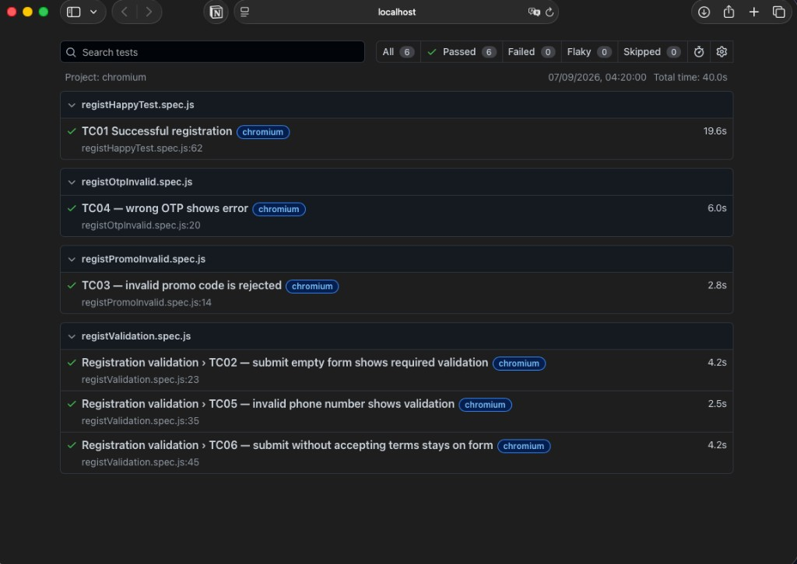

# QA Portfolio — Kanpitcha Sinitwarakun

Manual + Automation QA | Playwright (JavaScript) | Test Cases | Bug Reports

**Contact:** ksinitwarakun@gmail.com | 093-685-5954

---

## About me

QA engineer with a software development background. I design test cases, report defects clearly, retest fixes, and build Playwright automation for web flows. Interested in growing in QA outside gaming — including web/app products and AI-related software quality.

---

## What is in this portfolio

| Item | File | What it shows |
|------|------|----------------|
| Test case design | [samples/test-cases-registration.md](./samples/test-cases-registration.md) | Happy path + validation + edge cases |
| Bug report | [samples/bug-report-otp-ref.md](./samples/bug-report-otp-ref.md) | Structured defect report with severity & hypothesis |
| Automation run | [screenshots/playwright-report-registration.png](./screenshots/playwright-report-registration.png) | Playwright report — 6/6 passed (Chromium) |
| Automation source | Available on request / private Drive | Playwright E2E for registration (6 scenarios) |

> Sample documents below are **sanitized**. Company names, UAT URLs, and sensitive exam/client details are removed or generalized.

---

## Skills demonstrated

- Test case design (happy path, validation, edge cases)
- Bug reporting (steps, expected/actual, severity, evidence, impact)
- Web E2E automation with **Playwright**
- Git / basic CI awareness
- Collaboration with developers on defect follow-up

---

## Automation summary (Playwright)

Built an E2E suite for a **SaaS registration flow**, covering:

1. Successful registration + OTP + password + login  
2. Empty form validation  
3. Invalid promo code  
4. Wrong OTP  
5. Invalid phone format  
6. Submit without accepting terms  

**Stack:** Playwright + JavaScript + Chromium  
**Extras:** shared helpers, unique test data per run, headed demo recording

Source code and demo video can be shared privately for interview review.

---

## How to review

1. Read the test cases sample  
2. Read the bug report sample  
3. Request the Playwright project link if you want to inspect code/run output  

---

## Note for recruiters

I can walk through my testing approach in an interview: how I scope cases, prioritize risks, write reproducible bug reports, and decide what to automate first.
